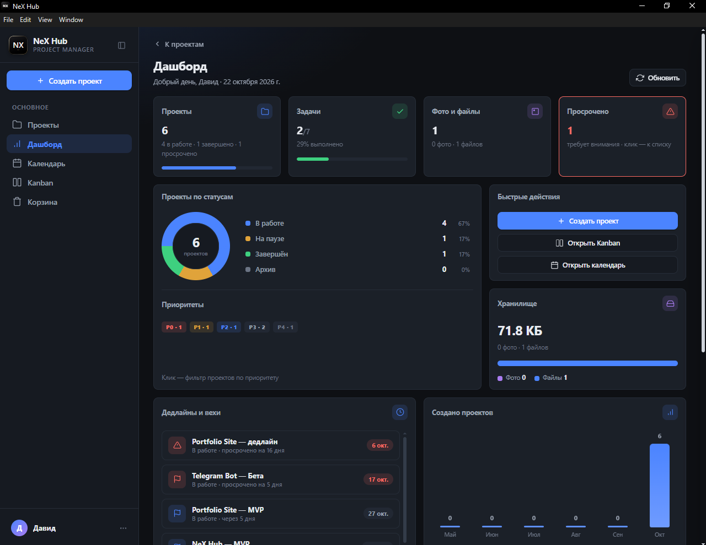
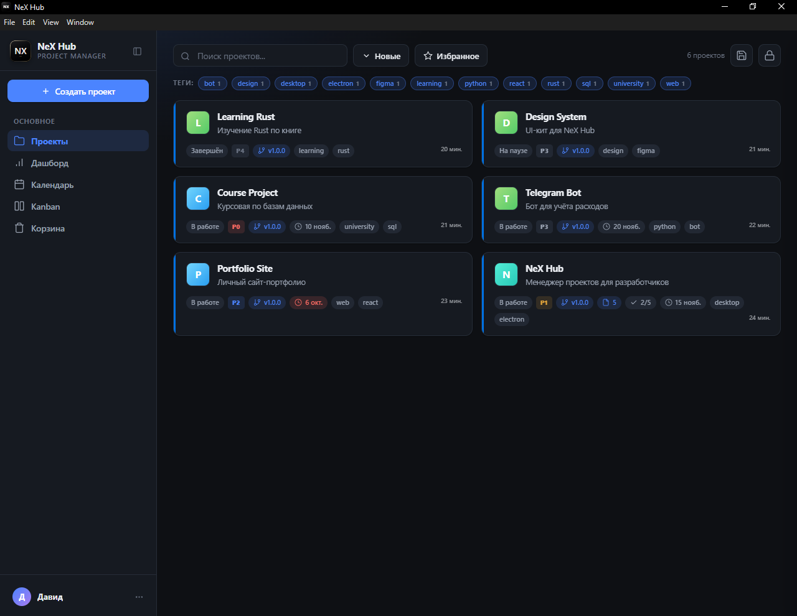
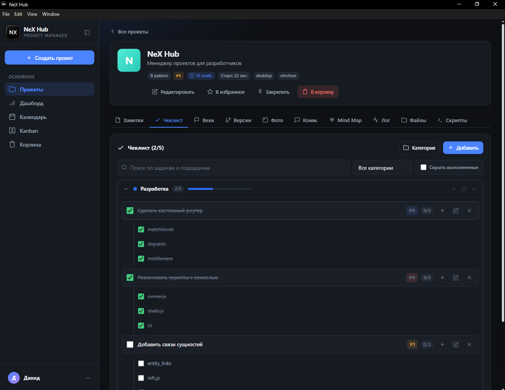
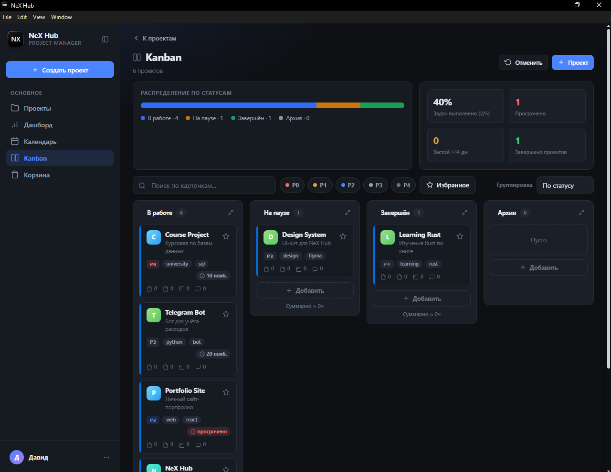
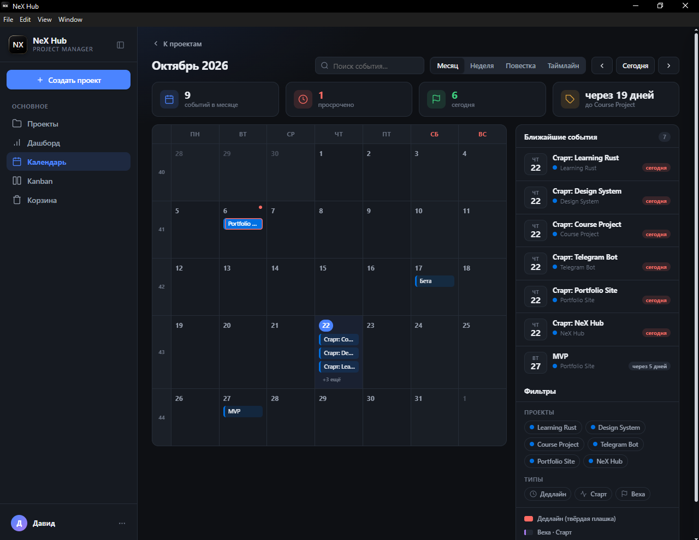
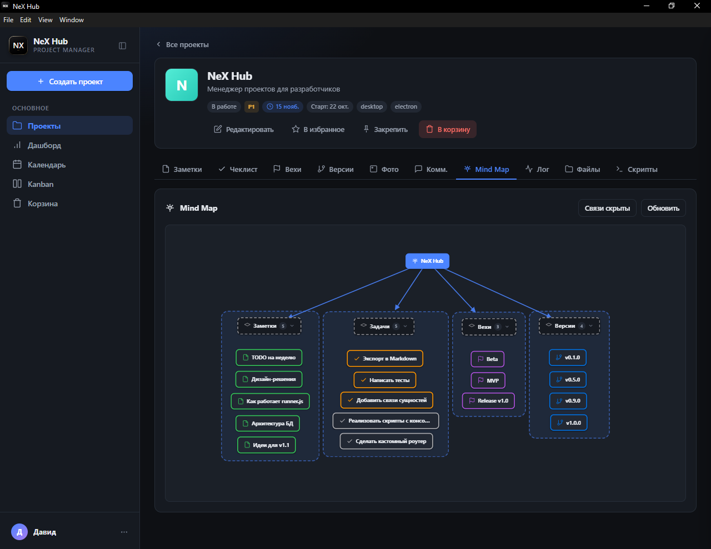
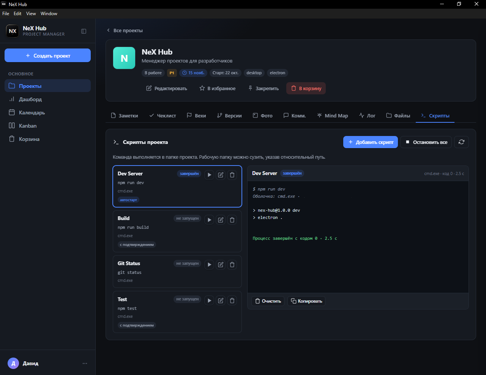

<div align="center">

# NeX Hub

**Локальный менеджер проектов для разработчиков**

Проекты, задачи, вехи, версии, файлы, скрипты и Mind Map — в одном офлайн-приложении.




[О проекте](#о-проекте) · [Скачать](#скачать) · [Возможности](#возможности) · [Скриншоты](#скриншоты) · [Технологии](#технологии) · [Установка](#быстрый-старт)

[](https://github.com/vinmer-nex/NeX-Hub/releases/latest/download/NeX%20Hub%20Setup.exe)

</div>

---

## О проекте

**NeX Hub** — настольное приложение для ведения проектов разработчика. Оно объединяет карточки проектов, заметки, чеклисты, вехи, версии, файлы, фото, комментарии и запуск локальных скриптов в одном интерфейсе.

Приложение работает локально: проекты и вложения хранятся на компьютере в SQLite-базе и папке загрузок. Для работы не нужны облачный аккаунт, интернет или внешний сервер. Поддерживается несколько локальных аккаунтов с раздельными данными.

NeX Hub ориентирован на Windows и распространяется как Electron-приложение с установщиком и портативной сборкой.

## Скачать

| Сборка | Ссылка |
|---|---|
| Установщик для Windows (NSIS) | **[NeX Hub Setup.exe](https://github.com/vinmer-nex/NeX-Hub/releases/latest/download/NeX%20Hub%20Setup.exe)** |
| Портативная версия и все релизы | [Releases](https://github.com/vinmer-nex/NeX-Hub/releases) |

Актуальная версия — **1.0.0**. Установщик не подписан цифровой подписью, поэтому Windows SmartScreen может показать предупреждение: нажмите **«Подробнее» → «Выполнить в любом случае»**.

## Возможности

### Проекты

- Карточки с логотипом, цветом, описанием, тегами и статусом: в работе, на паузе, завершён, архив.
- Приоритеты от P0 до P4, даты старта и дедлайна, оценка в часах.
- Избранное, закрепление, поиск, фильтры по статусу, приоритету и тегам, сортировка.
- Мягкое удаление и корзина с возможностью восстановления.
- Массовое выделение и контекстное меню на карточках.

### Рабочее пространство проекта

- **Заметки** — Markdown, подсветка кода, теги, закрепление, копирование, вложения и связи с задачами чеклиста.
- **Чеклист** — категории, приоритеты, подзадачи, вложения, прогресс и скрытие выполненных задач.
- **Вехи** — контрольные точки проекта с датой и описанием.
- **Версии** — история релизов с описанием, вложениями и связями с заметками и задачами.
- **Фото** — галерея изображений проекта.
- **Комментарии** — обсуждение внутри проекта.
- **Лог активности** — история действий по проекту.
- **Файлы** — привязка папки проекта, дерево файлов, предпросмотр кода и изображений, открытие в проводнике или внешнем редакторе.
- **Mind Map** — карта проекта, которая строится из заметок, задач, вех, версий и файлов; поддерживает собственные узлы, группы, связи, перетаскивание и предпросмотр сущностей.
- **Скрипты** — команды, привязанные к проекту: рабочая папка, переменные окружения, оболочка, подтверждение запуска, автозапуск, живой вывод в консоль, остановка и перезапуск.

### Обзор и планирование

- **Дашборд** — статистика по проектам и задачам, распределение по статусам и приоритетам, ближайшие дедлайны, активность и занятое место.
- **Календарь** — режимы «Месяц», «Неделя», «Повестка» и «Таймлайн», события проектов с перетаскиванием.
- **Kanban** — доска с drag-and-drop и группировкой по статусу, приоритету или тегу.

### Безопасность

- Несколько локальных аккаунтов с раздельными проектами.
- Пароли хранятся в виде bcrypt-хешей.
- Код восстановления доступа.
- PIN-код для блокировки приложения.
- Автоблокировка после заданного времени бездействия.
- Дополнительное подтверждение паролем для опасных действий.
- Режим «Запомнить меня».

### Оформление и данные

- Светлая, тёмная и системная темы.
- Восемь акцентных цветов.
- Настройка скруглений, плотности интерфейса, масштаба и шрифта.
- Экспорт и импорт проектов в JSON.
- Сброс данных аккаунта без удаления самого аккаунта.

## Скриншоты

| Проекты | Чеклист |
|:---:|:---:|
|  |  |
| <sub>Список проектов с тегами, приоритетами и сроками</sub> | <sub>Категории, подзадачи и прогресс</sub> |

| Kanban | Календарь |
|:---:|:---:|
|  |  |
| <sub>Группировка и перетаскивание карточек</sub> | <sub>Месяц, неделя, повестка и таймлайн</sub> |

| Mind Map | Скрипты |
|:---:|:---:|
|  |  |
| <sub>Карта проекта со связями между сущностями</sub> | <sub>Запуск команд и живой вывод консоли</sub> |

Дополнительные скриншоты — заметки, вехи, версии, настройки и форма создания проекта — находятся в папке [`docs/screenshots`](docs/screenshots).

## Технологии

| Слой | Технологии |
|---|---|
| Оболочка | Electron 42 |
| Интерфейс | Vanilla JavaScript (ES Modules), CSS |
| Хранение данных | SQLite, better-sqlite3, режим WAL |
| Аутентификация | bcryptjs |
| Идентификаторы | uuid |
| Сборка | electron-builder, NSIS и portable |
| Взаимодействие | IPC, preload, собственный протокол `app://` и мини-роутер |

Фронтенд не использует фреймворк и отдельный этап сборки: интерфейс загружается напрямую из `client/`.

## Структура проекта

```text
NeX Hub/
├─ electron/                 # Main process
│  ├─ main.js                # Точка входа Electron
│  ├─ preload.js             # Безопасный мост в renderer
│  ├─ ipc.js                 # IPC-обработчики
│  ├─ db.js                  # Схема SQLite и миграции
│  ├─ paths.js               # Пути к данным и загрузкам, чтение .env
│  ├─ session.js             # Аккаунты, безопасность, статистика
│  ├─ router.js              # Мини-роутер для app://
│  ├─ registerProtocol.js    # Регистрация протокола
│  ├─ controllers/           # Контроллеры проектов и скриптов
│  ├─ routes/                # Маршруты API
│  ├─ scripts/runner.js      # Запуск и остановка скриптов
│  ├─ workers/               # Фоновые воркеры (сканер редактора)
│  ├─ lib/                   # Связи, оболочки, миниатюры
│  └─ assets/                # Иконки приложения для окна и трея
├─ client/                   # Renderer
│  ├─ index.html
│  ├─ css/styles.css
│  └─ js/
│     ├─ components/         # Экраны и компоненты интерфейса
│     ├─ utils/              # DOM, форматирование, подсветка, экспорт и импорт
│     ├─ api.js              # Клиент IPC-запросов
│     ├─ app.js              # Инициализация приложения
│     ├─ config.js           # Константы: статусы, приоритеты, лимиты
│     ├─ store.js            # Состояние приложения
│     ├─ auth.js             # Текущий пользователь и сессия
│     ├─ security.js         # PIN-код и автоблокировка
│     ├─ appearance.js       # Темы, акценты, плотность, масштаб
│     ├─ theme.js            # Применение темы оформления
│     └─ icons.js            # SVG-спрайт иконок
├─ build/                    # Иконки для electron-builder
├─ docs/screenshots/         # Скриншоты для документации
├─ scripts/                  # Служебные скрипты и бенчмарки (bench/)
├─ .env.example              # Шаблон локальных настроек
├─ .env                      # Локальные настройки (не коммитится)
├─ package.json
└─ package-lock.json
```

Каталоги `data/`, `uploads/`, `save/`, `release/` и `node_modules/` создаются локально и не предназначены для публикации.

## Быстрый старт

### Требования

- Windows 10 или Windows 11.
- Node.js LTS и npm.

### Установка зависимостей

```bash
npm install
```

При необходимости скопируйте шаблон настроек и укажите свой редактор:

```bash
copy .env.example .env
```

Во время установки выполняется `scripts/fetch-native.js`: он подбирает prebuilt-бинарник `better-sqlite3` под ABI установленного Electron. Если готовой сборки для вашей платформы нет, нативную зависимость потребуется собрать локально.

### Запуск в режиме разработки

```bash
npm start
```

Команда `npm run dev` выполняет то же самое.

При первом запуске создайте локальный аккаунт и сохраните код восстановления — он понадобится, если вы забудете пароль.

### Сборка приложения

```bash
npm run dist
```

Результат появится в каталоге `release/`:

- установщик NSIS;
- портативный `.exe`.

## Где хранятся данные

В режиме разработки данные находятся в проекте:

```text
NeX Hub/
├─ data/projecthub.db
└─ uploads/
   ├─ photos/
   └─ files/
```

В установленном приложении база и загрузки размещаются в каталоге данных пользователя. Точный путь показан в приложении: **Настройки → Данные**.

Для резервной копии используйте **Настройки → Данные → Экспорт проектов в файл**. Импорт добавляет проекты из ранее экспортированного JSON.

## Ограничения

- Сборка и тестирование ориентированы на Windows; другие платформы не заявлены.
- Нет облачной синхронизации, совместной работы и доступа с нескольких устройств.
- Нет встроенного автообновления.
- Раздел «Уведомления» в настройках пока является заготовкой и не реализован.
- Открытие файлов во внешнем редакторе зависит от установленного редактора; путь можно задать через `EDITOR_CMD` в `.env`.
- Скрипты выполняются с правами текущего пользователя — запускайте только команды, которым доверяете.

---

<div align="center">
<sub>NeX Hub · локальный менеджер проектов</sub>
</div>
